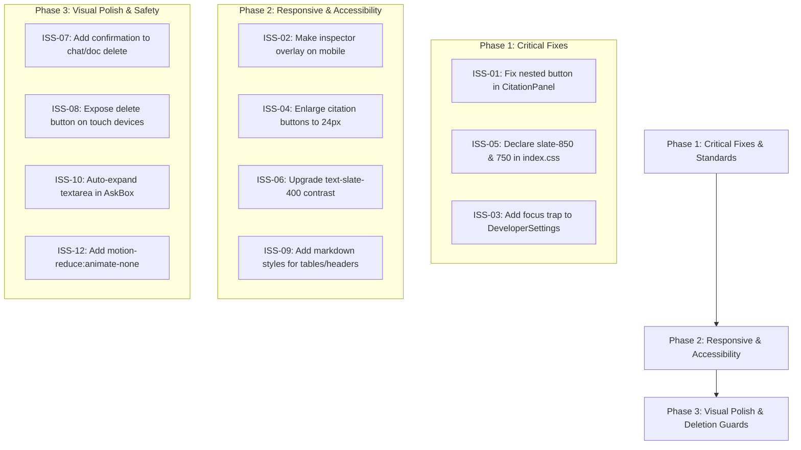

# Prioritized Minimal-Change Implementation Plan

**Objective:** Elevate the current **Ask My Docs** frontend to production-grade visual polish, responsive resilience, and WCAG 2.2 AA accessibility while strictly preserving existing architecture, routes, styling framework, and business logic.

---

## 1. Categorization of Recommendations

### 1.1 Must Fix (P0 & P1 — Critical & High Severity)
*Verified issues affecting usability, HTML5 compliance, accessibility, or broken visual tokens.*

1. **ISS-01 (P0): Fix Nested Interactive Elements in Citation Panel (`CitationPanel.tsx`)**
   - *Problem:* A clickable `<span>` ("Open in viewer →") is nested inside a parent `<button>`, violating W3C HTML5 specs and blocking keyboard accessibility.
   - *Fix:* Restructure citation cards into `<article>` elements containing independent sibling buttons: one to highlight the citation in the answer, and one to open the document viewer.
2. **ISS-02 (P0/P1): Responsive Inspector Drawer on Mobile (`App.tsx`)**
   - *Problem:* Opening the right inspector panel applies fixed `w-80` (320px) in a flex row, compressing the main conversation stage to ~55px on a 375px viewport and 0px on 320px screens.
   - *Fix:* On screens below `768px` (`md`), render the inspector drawer as a full-width overlay with a backdrop: `fixed inset-0 z-30 md:static md:w-80 lg:w-[480px]`.
3. **ISS-03 (P1): Dialog Focus Trapping in Developer Settings (`DeveloperSettings.tsx`)**
   - *Problem:* Tabbing past the save button allows focus to escape into the background DOM behind the modal.
   - *Fix:* Implement a lightweight keyboard focus trap loop inside the modal container.
4. **ISS-04 (P1): Expand Touch Target Size for Citation Chips (`AnswerView.tsx`)**
   - *Problem:* Citation pills (`h-5 min-w-5`, 20×20px) fail WCAG 2.2 AA SC 2.5.8 (Target Size Minimum 24×24px).
   - *Fix:* Upgrade button classes to `h-6 min-w-6 px-1.5 text-xs` (24×24px) or apply pseudo-element touch pads (`before:absolute before:-inset-1`).
5. **ISS-05 (P1): Resolve Non-Existent Tailwind v4 Tokens (`App.tsx`, `DocumentViewer.tsx`, `AskBox.tsx`)**
   - *Problem:* Classes `dark:bg-slate-850` and `dark:hover:bg-slate-750` do not exist in Tailwind v4 and fail silently to transparent backgrounds.
   - *Fix:* Normalize all occurrences to standard `dark:bg-slate-800` / `dark:bg-slate-900` or declare missing tokens in `frontend/src/index.css` under `@theme`.

---

### 1.2 Should Improve (P2 — Medium Severity)
*Meaningful improvements to visual quality, contrast, and workflow efficiency.*

1. **ISS-06 (P2): Contrast Hardening for Muted Text (`AskBox.tsx`, `App.tsx`)**
   - *Problem:* `text-slate-400` on white (#ffffff) is 2.8:1, failing the 4.5:1 ratio requirement.
   - *Fix:* Upgrade light mode muted text to `text-slate-500` (4.6:1) and dark mode to `dark:text-slate-400` (5.2:1).
2. **ISS-07 (P2): Confirmation Guardrail for Document & Session Deletion (`UploadPanel.tsx`, `App.tsx`)**
   - *Problem:* Tapping `×` deletes uploaded documents or chat sessions immediately with no undo or confirmation.
   - *Fix:* Implement a two-step confirm or inline *"Delete?"* toggle state before executing deletion mutation.
3. **ISS-08 (P2): Mobile Discovery of Delete Buttons (`UploadPanel.tsx`, `App.tsx`)**
   - *Problem:* Delete icons use `opacity-0 group-hover:opacity-100`, making them invisible on touchscreens.
   - *Fix:* Use `@media (hover: hover)` or provide persistent default opacity (`opacity-60 hover:opacity-100`) on touch devices.
4. **ISS-09 (P2): Structured Markdown Styling for LLM Responses (`AnswerView.tsx`)**
   - *Problem:* Missing renderers for markdown tables, blockquotes, and headings (`h1`-`h3`) cause uneven formatting when LLMs generate comparative summaries.
   - *Fix:* Add custom ReactMarkdown components for `table`, `th`, `td`, `blockquote`, and `h1-h3` with subtle borders and typography scaling.

---

### 1.3 Optional Polish (P3 — Low Severity)
*Minor visual refinements that do not alter core user workflows.*

1. **ISS-10 (P3): Auto-Expanding Textarea in AskBox (`AskBox.tsx`)**
   - *Problem:* Hardcoded `rows={2}` produces a scrollbar for longer multi-line questions.
   - *Fix:* Dynamically resize height up to `max-h-36` as the user types.
2. **ISS-11 (P3): Accessible Modal Close Button (`DeveloperSettings.tsx`)**
   - *Problem:* Uses raw `×` text instead of an accessible SVG icon and descriptive aria label.
   - *Fix:* Replace with standard `<svg>` close icon and `aria-label="Close developer settings"`.
3. **ISS-12 (P3): Vestibular Motion Preference Support (`AnswerView.tsx`, `AskBox.tsx`)**
   - *Problem:* Continuous pulsing indicators run without checking `prefers-reduced-motion`.
   - *Fix:* Add `motion-reduce:animate-none` to all pulsing indicators.

---

### 1.4 Keep As Is
*High-performing existing patterns requiring zero modification.*

- **Floating AskBox Positioning:** Anchoring the input container to the central chat stage (`main.relative` with `absolute inset-x-0 bottom-0`) keeps it perfectly centered regardless of whether the right drawer is opened or closed.
- **Dynamic First-Time Empty State:** The dual-mode empty state (greeting + prominent upload dropzone for newcomers vs post-upload confirmation + customized starters) provides exceptional clarity.
- **Accidental Reload Guardrail:** The `beforeunload` listener in `useChatSession.ts` protecting against accidental page reloads effectively safeguards browser-ephemeral chats.
- **Document Viewer Dual-Mode:** Providing both raw PDF iframe and extracted text Chunks with real-time substring filtering is an outstanding technical design.
- **Developer Settings Hot-Swapping:** In-memory provider and model switching without restarting backend containers is reliable and developer-friendly.

---

## 2. Before-and-After Technical Recommendations

### Recommendation 1: Repairing Invalid Dark Mode Tokens
- **Current UI & Code:**
  ```tsx
  // frontend/src/App.tsx:L198
  className="... dark:border-slate-800 dark:bg-slate-850 dark:text-slate-200"
  // frontend/src/components/DocumentViewer.tsx:L249
  className="... dark:border-slate-800 dark:bg-slate-850"
  ```
- **Proposed Correction:**
  Update `frontend/src/index.css`:
  ```css
  @theme {
    --font-sans: "Inter", -apple-system, BlinkMacSystemFont, "Segoe UI", Roboto, sans-serif;
    --font-mono: ui-monospace, SFMono-Regular, Menlo, Monaco, Consolas, monospace;
    --color-slate-750: #243044;
    --color-slate-850: #131c2e;
  }
  ```
- **Reason:** Tailwind v4 requires custom colors to be declared under `@theme`. Without this, elements render with transparent backgrounds in dark mode.
- **Expected Improvement:** Crisp surface hierarchy and proper card depth in dark mode.
- **Validation:** Inspect rendered computed style in browser developer tools under `prefers-color-scheme: dark`; verify `background-color` evaluates to `rgb(19, 28, 46)`.

---

### Recommendation 2: Eliminating Nested Interactive Controls in Citation Cards
- **Current UI & Code:**
  ```tsx
  // frontend/src/components/CitationPanel.tsx:L59-L101
  <button type="button" onClick={() => onSelect(c.n)} ...>
    ...
    <div className="...">
      <span onClick={(e) => { e.stopPropagation(); onViewDoc(c.doc_id); }} className="...">
        Open in viewer →
      </span>
    </div>
  </button>
  ```
- **Proposed Correction:**
  ```tsx
  <article className={`w-full rounded-xl border p-3 transition-all ${
    selected ? "border-indigo-500 bg-indigo-50/70 dark:bg-indigo-950/20" : "border-slate-200 bg-white dark:bg-slate-900"
  }`}>
    <button type="button" onClick={() => onSelect(c.n)} className="w-full text-left">
      <div className="flex items-baseline gap-2">
        <span className="inline-flex h-5 min-w-5 items-center justify-center rounded-full bg-indigo-600 px-1.5 text-[11px] font-semibold text-white">
          {c.n}
        </span>
        <span className="min-w-0 flex-1 truncate text-xs font-semibold text-slate-800 dark:text-slate-200" title={c.file_name}>
          {c.file_name}
        </span>
        {c.page !== null && <span className="shrink-0 font-mono text-[11px] text-slate-400">p. {c.page}</span>}
      </div>
      <p className="mt-2 text-xs leading-relaxed text-slate-700 dark:text-slate-300">
        {selected ? highlight(c.snippet, sentencesCiting(answer, c.n)) : c.snippet}
      </p>
    </button>
    {onViewDoc && (
      <div className="mt-2.5 pt-2 border-t border-slate-100 flex justify-end dark:border-slate-800">
        <button
          type="button"
          onClick={() => onViewDoc(c.doc_id)}
          className="text-[11px] font-medium text-indigo-600 hover:text-indigo-700 hover:underline dark:text-indigo-400"
        >
          Open in viewer →
        </button>
      </div>
    )}
  </article>
  ```
- **Reason:** HTML5 spec forbids nested interactive elements. Screen readers cannot expose child clickables inside buttons.
- **Expected Improvement:** Keyboard users can press `Tab` to navigate directly to "Open in viewer →" and activate it with `Enter`.
- **Validation:** Run automated accessibility audit or test keyboard navigation with `Tab` and `Shift+Tab`.

---

### Recommendation 3: Mobile-Friendly Inspector Drawer
- **Current UI & Code:**
  ```tsx
  // frontend/src/App.tsx:L636
  <aside className={`flex flex-col border-l border-slate-200 bg-white transition-all duration-200 dark:border-slate-800 dark:bg-slate-900 ${
    rightPanelOpen ? "w-80 lg:w-[480px]" : "w-0 overflow-hidden"
  }`}>
  ```
- **Proposed Correction:**
  ```tsx
  <aside className={`flex flex-col border-l border-slate-200 bg-white transition-all duration-200 dark:border-slate-800 dark:bg-slate-900 ${
    rightPanelOpen 
      ? "fixed inset-0 z-30 w-full sm:static sm:w-80 lg:w-[480px]" 
      : "w-0 overflow-hidden"
  }`}>
  ```
- **Reason:** On viewports under `640px` / `768px`, side-by-side flex panes shrink the main chat area down to 0-55px, rendering conversation cards completely broken.
- **Expected Improvement:** On mobile, opening a document or citations displays a dedicated, full-screen drawer with an easy close button, keeping the underlying chat safe and intact.
- **Validation:** Resize viewport to 375px; toggle inspector panel; verify chat remains full width when closed and inspector takes 100% width when open.

---

### Recommendation 4: Expanding Citation Chip Touch Targets
- **Current UI & Code:**
  ```tsx
  // frontend/src/components/AnswerView.tsx:L49
  className={`mx-0.5 inline-flex h-5 min-w-5 items-center justify-center rounded-full px-1.5 align-[2px] text-[11px] font-semibold ...`}
  ```
- **Proposed Correction:**
  ```tsx
  className={`mx-0.5 inline-flex h-6 min-w-6 items-center justify-center rounded-full px-2 align-[2px] text-xs font-semibold ...`}
  ```
- **Reason:** 20×20px buttons violate WCAG 2.2 SC 2.5.8 (minimum 24×24px).
- **Expected Improvement:** Significantly easier tapping on touchscreens, preventing mis-clicks when multiple citations are adjacent.
- **Validation:** Inspect element bounding box in Chrome DevTools; verify computed dimensions are `>= 24px × 24px`.

---

## 3. Phased Implementation Roadmap



### Phase 1: Critical Fixes & Standards Compliance (Estimated: ~2 Hours)
1. Add custom color tokens `--color-slate-750` and `--color-slate-850` to `frontend/src/index.css`.
2. Refactor `CitationPanel.tsx` to separate citation card selection from the "Open in viewer" button.
3. Add Tab-key focus containment in `DeveloperSettings.tsx`.

### Phase 2: Responsive & Accessibility Hardening (Estimated: ~3 Hours)
1. Add `fixed inset-0 z-30 sm:static` responsive breakpoint to right inspector panel in `App.tsx`.
2. Enlarge citation chip buttons in `AnswerView.tsx` to 24×24px.
3. Update muted labels from `text-slate-400` to `text-slate-500` / `dark:text-slate-400`.
4. Add markdown component styles for `table`, `th`, `td`, and `blockquote` in `AnswerView.tsx`.

### Phase 3: Visual Polish & Safety Guardrails (Estimated: ~2 Hours)
1. Implement inline confirmation for deleting chat sessions in `App.tsx` and documents in `UploadPanel.tsx`.
2. Show delete buttons with soft default opacity on touchscreens.
3. Implement dynamic height auto-expansion for the textarea in `AskBox.tsx`.
4. Append `motion-reduce:animate-none` to streaming pulse and ping indicators.

---

## 4. Execution Guidance Note
As mandated by the audit protocol, **no source code changes have been applied**. When authorized to proceed with implementation, execute Phase 1 through Phase 3 incrementally and validate each change using Vitest (`npm test`) and responsive browser emulation.
